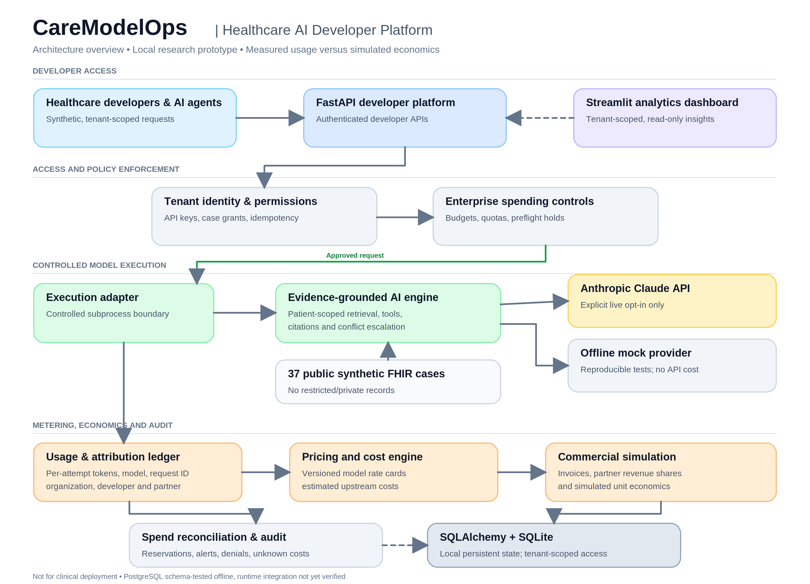

# CareModelOps

**Healthcare AI Developer Platform — Claude Integration, Usage Metering, Monetization, and Enterprise Governance**

CareModelOps is an **independent, local-first developer-platform prototype** that demonstrates how healthcare software teams can integrate foundation models, attribute usage to developers and partners, estimate costs, simulate commercial models, and govern AI spending. It combines a FastAPI control plane and a Streamlit analytics interface with an evidence-grounded clinical AI engine operating on **public synthetic FHIR cases**.

The project extends the clinical evidence and safety concepts from [ChartGround — Evidence-Grounded Agentic AI for Longitudinal Health Records](https://github.com/vis6060/ChartGround-Evidence-Grounded-Agentic-AI-for-Longitudinal-Health-Records). It is **not affiliated with or endorsed by Anthropic**. It is a research and product-development demonstration, **not a clinical system or a payment service**.

## Architecture



[Open the scalable SVG architecture diagram](docs/assets/caremodelops-architecture.svg)

CareModelOps is organized around six interacting capabilities:

- **Developer platform:** Tenant-authenticated FastAPI services, organization-specific synthetic-case permissions, agent attribution, and idempotent execution.
- **Evidence-grounded AI execution:** Patient-scoped evidence retrieval, deterministic clinical tools, source citations, conflict identification, uncertainty handling, and escalation, using public synthetic FHIR data.
- **Model access:** Anthropic Claude API integration with explicit opt-in for live calls; an offline mock path supports reproducible tests without API charges.
- **Usage and monetization:** Per-attempt token and model-request metering, versioned price cards, estimated upstream model cost, fictional customer plans, simulated invoices, partner attribution, and unit economics.
- **Enterprise governance:** Organization and agent budgets, request quotas, atomic preflight reservations, budget denials, cost reconciliation, alerts, and audit records.
- **Developer analytics:** A Streamlit dashboard consuming authenticated, tenant-scoped APIs to display usage, cost estimates, fictional commercial economics, and spending controls.

**Technology:** Python, FastAPI, SQLAlchemy, SQLite, Streamlit, Anthropic Claude API, and synthetic FHIR data. The implemented runtime uses local SQLite. PostgreSQL schema compatibility has been checked offline; a running PostgreSQL deployment has not been integration-validated.

> **Measurement boundary:** Actual API token usage (where collected) is not the same as an upstream cost estimate. Customer charges, invoices, revenue-sharing arrangements, and gross-margin figures in this prototype are **fictional commercial simulations**, not real customer transactions.

## What the platform demonstrates

| Area | Implemented capability | Important boundary |
| --- | --- | --- |
| AI integration | Claude-backed synthetic clinical workflow and local mock execution | Live requests require explicit opt-in and an API key |
| Developer platform | API-key authentication, tenant grants, agents, idempotency, and per-attempt ledger | Local prototype; no production identity or key-management UI |
| Pricing and economics | Versioned rates, token-based cost estimation, simulated plans and invoices | Prices and customer economics are illustrative and may not reflect current provider terms |
| Partner distribution | Direct versus partner attribution and simulated revenue shares | No actual partner settlement or payment processing |
| Enterprise controls | Budgets, quotas, preflight holds, denial, reconciliation, and local alerts | Not a guarantee of exactly-once remote-model billing |
| Analytics | Tenant-scoped usage, commercial, and spending-control views | Historical conversion or retention must not be inferred from sparse events |
| Clinical evidence | Retrieval, citations, structured tools, and escalation | Synthetic-data research only; no clinical validation |

## Request and data flow

A developer authenticates against the FastAPI service with an organization-specific key. The API validates case and agent permissions and the idempotency key. A spending-control preflight determines whether to reserve an estimated maximum cost. Approved runs invoke a controlled subprocess adapter, which uses the ChartGround clinical evidence engine and either an explicitly enabled Claude provider or the offline mock path. Recorded API attempts feed the usage ledger; the pricing and governance layers derive estimated costs, reconciliation state, simulated billing, partner economics, and alerts. The dashboard retrieves authorized views **through the API**, not through direct cross-tenant database access.

Only public synthetic case inputs are accepted in the developer-platform inference workflow. Private MIMIC records and private clinical evaluations are not part of the public repository or the permitted Claude demonstration path.

## Run locally (Windows PowerShell)

Use Python 3.11 and a local virtual/Conda environment. The example below assumes the existing `chartground-claude` Conda environment; see the setup notes in `docs/` for dependency and configuration details.

```powershell
conda activate chartground-claude
cd C:\path\to\caremodelops
python -m pip install -r requirements-m5.txt
python scripts/seed_m2.py
python -m pytest -q
```

The original local development baseline passed **151 offline tests** in both the working directory and a clean Git clone using a configured environment. A newly initialized database does **not** ship with real Claude usage records or historical fictional invoices; the dashboard may therefore show empty states.

### Start the API

In PowerShell window 1:

```powershell
conda activate chartground-claude
cd C:\path\to\caremodelops
Remove-Item Env:CHARTGROUND_M2_ALLOW_CLAUDE -ErrorAction SilentlyContinue
$env:PYTHONPATH = "$PWD\src"
python -m uvicorn chartground.platform_m5.api:create_app --factory --host 127.0.0.1 --port 8000
```

API documentation: <http://127.0.0.1:8000/docs>

### Start the analytics dashboard

In PowerShell window 2:

```powershell
conda activate chartground-claude
cd C:\path\to\caremodelops
$env:CHARTGROUND_M5_DEMO = "1"
$env:CHARTGROUND_API_URL = "http://127.0.0.1:8000"
python -m streamlit run scripts/m5_dashboard.py
```

Dashboard: <http://localhost:8501>

The local demo uses fictional organizations such as **OncoPilot** (direct) and **RadPath** (partner-attributed through fictional **MedData Partners**). Credentials are generated locally and must never be committed. Live Claude access remains disabled unless the separate live opt-in is deliberately enabled.

## Repository layout

```text
caremodelops/
├── README.md
├── docs/
│   ├── assets/
│   │   ├── caremodelops-architecture.png
│   │   └── caremodelops-architecture.svg
│   └── ...                    # Local setup and technical documentation
├── src/chartground/          # Clinical engine and developer-platform modules
├── scripts/                  # Demos, seeding, validation, and dashboard
├── tests/                    # Offline unit and integration tests
├── data/public_synthetic/    # Synthetic cases and reviewed test fixtures
└── requirements*.txt         # Python dependencies
```

Internal implementation module names may retain their original development identifiers; these are not product-facing architectural boundaries.

## Privacy, limitations, and responsible use

- **Synthetic research data only:** Patient-level private records, restricted datasets, local databases, `.env` files, credentials, and private evaluation outputs are not intended for this public repository.
- **No clinical use:** Do not use CareModelOps for diagnosis, treatment recommendations, autonomous care decisions, or patient-facing clinical deployment.
- **Provider usage is conditional:** Offline test results and mocked responses must not be represented as measured Claude performance. Live inference requires deliberate authorization and may incur API charges.
- **Commercial simulation only:** Customer invoices, commitments, partner settlements, revenue, and margins are illustrative. No money changes hands.
- **Prototype limitations:** The local platform does not establish production security, regulatory compliance, high availability, a validated PostgreSQL deployment, or an exactly-once guarantee across a remote model API and local ledger.

## Further documentation

The `docs/` directory contains local installation notes and the detailed implementation contracts for tenant access, per-attempt metering, simulated commercial economics, enterprise spending controls, and analytics. The underlying [ChartGround project](https://github.com/vis6060/ChartGround-Evidence-Grounded-Agentic-AI-for-Longitudinal-Health-Records) documents the clinical evidence and evaluation foundation.

---

**CareModelOps is an independent portfolio and engineering-research prototype. It is not affiliated with Anthropic and does not claim clinical or commercial production readiness.**
